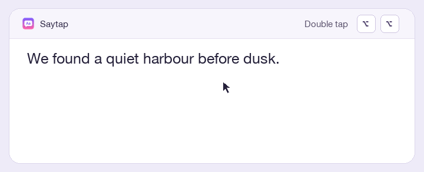
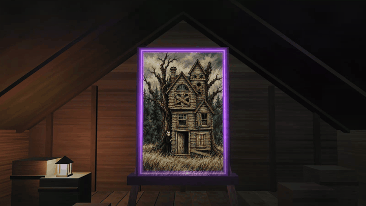

# Hi, I’m Vitaly

I build web apps with Ruby on Rails, native macOS tools with Swift, and browser games.

## Saytap

Select an English word on your Mac and tap Option twice to hear it pronounced and see its translation next to the cursor.

[Visit website](https://vitalyliber.github.io/saytap/) · [View source](https://github.com/vitalyliber/saytap)

## The House Inside the Painting

A 3D browser adventure where you step into a painting and explore an old house in the woods.

[Play in browser](https://spooky.casply.com/games/portrait-house)

[Telegram](https://t.me/vitalyliber) · [Blog](https://t.me/s/useruby)
